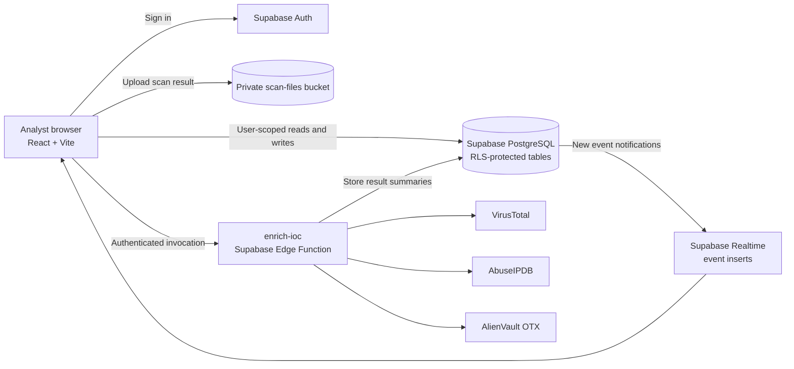

# SentinelBoard

**A full-stack SOC analyst workbench for organizing security events, investigating indicators of compromise, and tracking incidents.**

[](https://sentinelboard-six.vercel.app)

SentinelBoard is a portfolio project built around real analyst workflows. It stores workspace data in Supabase, applies row-level security, and enriches indicators through server-side threat-intelligence integrations.

**Live app:** [sentinelboard-six.vercel.app](https://sentinelboard-six.vercel.app)

> This README describes the current MVP. The Settings route is a placeholder, and scan files are results to upload and review; SentinelBoard does not launch scanners.

## Screenshots

These are captures of SentinelBoard's actual UI components populated with public security records. The event feed shows entries from CISA's KEV catalog release `2026.11.04`, with CVSS 3.1 ratings retrieved from NVD on `2026-11-06`. The ATT&CK view uses techniques cited in CISA/FBI advisory AA25-022A. The public records are rendered locally for these screenshots; they were not added to the production workspace, and SentinelBoard does not automatically ingest CISA KEV data.


Sources: [CISA Known Exploited Vulnerabilities catalog](https://www.cisa.gov/known-exploited-vulnerabilities-catalog), [CISA KEV JSON feed](https://www.cisa.gov/sites/default/files/feeds/known_exploited_vulnerabilities.json), [NVD CVE API](https://services.nvd.nist.gov/rest/json/cves/2.0), [CISA/FBI AA25-022A advisory](https://www.cisa.gov/sites/default/files/2025-02/aa25-022a-threat-actors-chained-vulnerabilities-in-ivanti-cloud-service-applications_2.pdf), and [MITRE ATT&CK Enterprise](https://attack.mitre.org/).

## Features

- **Dashboard:** workspace counts and recent events and incidents, queried from the signed-in user's data.
- **IOC enrichment:** validate and submit IP addresses, domains, URLs, MD5 hashes, and SHA-256 hashes; view cached results and provider summaries from VirusTotal, AbuseIPDB, and AlienVault OTX where supported.
- **Security event feed:** import event JSON, filter events, inspect details, tag events with MITRE ATT&CK techniques, and receive new events through Supabase Realtime. Bundled development events are labeled as fictional telemetry; imported and live workspace events retain their own provenance.
- **ATT&CK map:** search the bundled Enterprise ATT&CK technique data and review event tags.
- **Scan results:** upload Nuclei JSON/JSONL or Nmap XML results up to 10 MB. Files are parsed in the browser; the source file is stored in a private Supabase Storage bucket.
- **Incident tracker:** create incidents, transition their status, attach events and IOCs, review an activity timeline, and download a Markdown report.
- **Authentication:** email and password sign-up/sign-in with email confirmation.

## Tech stack

| Area | Technologies |
| --- | --- |
| Frontend | React 19, TypeScript, Vite 8, Tailwind CSS 4 |
| UI and visualization | Radix UI primitives, shadcn-style components, Sonner, Lucide, Recharts |
| Data access | Supabase JavaScript client, TanStack Query, React Router |
| Backend | Supabase Auth, PostgreSQL with RLS, Realtime, Storage, Edge Functions |
| Deployment | Vercel |
| Threat intelligence | VirusTotal API v3, AbuseIPDB API v2, AlienVault OTX API v1 |
| Technique reference | Bundled MITRE ATT&CK Enterprise data |

## Architecture



The browser uses the Supabase anon key and a signed-in user's session. RLS limits access to that user's records. Provider API keys stay in Supabase Edge Function secrets; they are never shipped to the browser.

## Local development

### Requirements

- Node.js `^20.19.0` or `>=22.12.0`, plus npm
- A Supabase project with the SentinelBoard database schema, RLS policies, `events` Realtime publication, and private `scan-files` bucket configured
- Provider API keys configured as Supabase Edge Function secrets to use live IOC enrichment

### Start the frontend

```bash
git clone https://github.com/nonbothack/SentinelBoard.git
cd SentinelBoard
npm install
```

Create `.env.local` with the two frontend values, then start Vite:

```dotenv
VITE_SUPABASE_URL=https://YOUR_PROJECT_REF.supabase.co
VITE_SUPABASE_ANON_KEY=YOUR_SUPABASE_ANON_KEY
```

```bash
npm run dev
```

Vite serves the app at `http://localhost:5173`. Add that URL to Supabase Auth's allowed redirect URLs for local email confirmation. The Supabase Site URL and redirect allowlist must also include the production app URL when deploying.

### Supabase setup notes

The deployed project was provisioned with the base schema and storage configuration during SB-002. This repository currently contains the `incident_activity` migration and ATT&CK seed data, but does not contain a baseline migration for all original tables. A fresh Supabase project therefore needs that baseline schema and policies provisioned before the app can be used; running the frontend setup commands alone does not create them.

To link the Supabase CLI to a project and deploy the enrichment function:

```bash
npx supabase@latest login
npx supabase@latest link --project-ref YOUR_PROJECT_REF
npx supabase@latest functions deploy enrich-ioc
```

Before invoking enrichment, configure `VT_API_KEY`, `ABUSEIPDB_API_KEY`, and `OTX_API_KEY` as Edge Function secrets in the Supabase project settings. Use the dashboard's secret fields or a secure secret manager; avoid pasting key values into shell commands. Do not put provider keys in `.env.local`, Vercel frontend variables, or committed files. Only the Supabase URL and anon key belong in the frontend environment.

## Database overview

The app reads and writes the following Supabase tables. User-owned rows are protected by RLS; `attack_techniques` is shared reference data.

| Table | Purpose |
| --- | --- |
| `profiles` | Application profile linked to Supabase Auth |
| `events` | Normalized security events and provenance marker |
| `iocs` | User-submitted indicators |
| `ioc_enrichments` | Per-provider status, summary, and stored response |
| `attack_techniques` | Bundled Enterprise ATT&CK reference data |
| `event_techniques` | Event-to-technique tags |
| `scan_uploads` | Uploaded scan-file metadata and parse status |
| `scan_findings` | Findings parsed from scan files |
| `incidents` | Incident case and status |
| `incident_iocs` | Incident-to-IOC links |
| `incident_events` | Incident-to-event links |
| `incident_activity` | Incident investigation timeline |

The private `scan-files` Storage bucket contains source scan files under a user-scoped path. The `events` table is published to Supabase Realtime for the live feed.

## API integrations

- **VirusTotal v3:** IP, domain, URL, and file-hash lookups. URL submissions use the `/urls` endpoint and read the resulting `/analyses/{id}` analysis.
- **AbuseIPDB v2:** IP address checks.
- **AlienVault OTX:** IP, domain, and file-hash context. OTX does not enrich URL indicators in this implementation.
- **MITRE ATT&CK:** Enterprise technique data is bundled with the app; technique lookup does not call a remote API on each view.

Each applicable provider is queried independently, so a provider error or rate limit can be shown alongside other provider results. Provider quotas and response coverage depend on the providers' current plans.

## Security considerations

- Enable and maintain RLS on user-owned tables; frontend access uses the Supabase anon key and authenticated session.
- Keep VirusTotal, AbuseIPDB, and OTX keys in Supabase Edge Function secrets. Never expose a service-role key or provider key in browser code.
- Scan files are limited to 10 MB, parsed in the browser, and stored in a private bucket with a user-scoped storage path.
- Treat imported event and scan content as untrusted input. Avoid importing sensitive telemetry into the publicly accessible deployment.
- Configure Supabase Auth Site URL and redirect allowlist for the production domain and local development origins.

## Known limitations

- The Settings page is an MVP-scope placeholder.
- Scan visualization accepts existing Nuclei or Nmap output; it does not run scans.
- Event JSON import is implemented; CSV import and webhook ingestion are not part of this MVP.
- The live feed subscribes to event inserts; it is not a general-purpose streaming pipeline.
- IOC verdicts reflect provider data available at query time, can be cached, and can be incomplete or rate-limited.
- The initial database schema is not tracked as a baseline migration in this repository, which limits clean-room backend setup.
- No AI-generated analysis or automated remediation is included.

## Author

Built by [@nonbothack](https://github.com/nonbothack). The developer profile includes a Google Vulnerability Reward Program P2/S2 bug bounty with $500 paid and the Google Cybersecurity Professional Certificate in progress.
